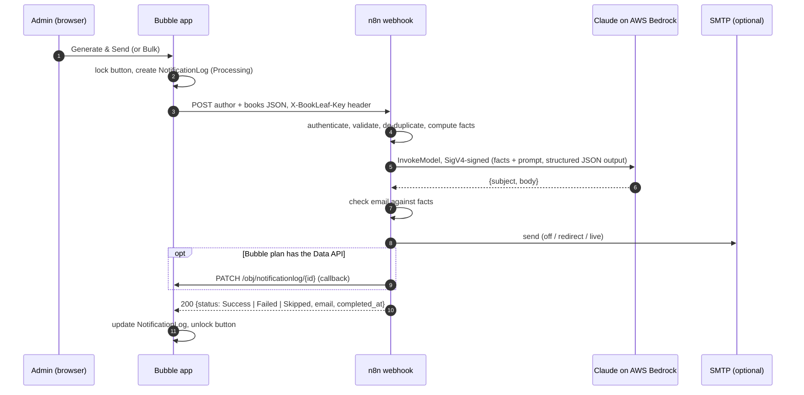

# BookLeaf: Author Royalty Dashboard & Automated Notification System

Assignment 2. **Bubble.io** app (authors and ops), **n8n** automation, **Claude on AWS Bedrock** for the email text.

Authors log in to see their books, royalties and a green/yellow/red payout badge per book. Ops admins see every author, filter by city or payout status, and trigger an AI-written royalty summary email for one author or for every author with pending royalties. n8n does the work and reports Success/Failed back into a notification log in Bubble.

| Deliverable | Where |
|---|---|
| Bubble app | https://pranavkr1503.bubbleapps.io/version-test/index (test logins below) |
| n8n workflow export | [`n8n/bookleaf_royalty_summary.workflow.json`](n8n/bookleaf_royalty_summary.workflow.json) |
| Bubble build reference (schema, privacy rules, every workflow) | [`docs/BUBBLE_BUILD_GUIDE.md`](docs/BUBBLE_BUILD_GUIDE.md) |
| Data import files | [`data/bubble_import/`](data/bubble_import/), generated from `bookleaf_sample_data.json` |
| Prompt | [`n8n/src/prompt.js`](n8n/src/prompt.js) |
| Tests | [`n8n/test/`](n8n/test/): unit tests, end-to-end run in real n8n, live prompt check |

The app is on Bubble's Free plan, which can't deploy to Live, so the link above is the development version (`version-test`). It runs the same pages, workflows and privacy rules against the test database.

**Test logins**

| Role | Email | Password |
|---|---|---|
| Admin | admin@bookleaf.test | testOasswird |
| Author | priya.sharma@email.com | testOasswird |
| Author (for the isolation test) | rohit.kapoor@email.com | testOasswird |

These are test accounts on test data. Email sending is off (`email_mode = off`), so a summary is written into the notification log and nothing is mailed to the sample authors.

---

## 1. Architecture



**One result, two ways back to Bubble.** Every outcome n8n handles ends in a single result object: `status`, `completed_at`, the email, any error, and the n8n execution ID. n8n returns it as the webhook response, and when the Bubble Data API is available it also PATCHes it straight onto the log row (the callback in step 5 of the brief). I built both deliberately. Bubble's pricing comparison lists "Bubble app API" as **not available on the Free plan**, so on Free the response is the only route back. On a paid plan the callback makes the log correct even if the admin's browser closes mid-run. Both routes write the same values, so it doesn't matter which arrives first.

## 2. Bubble database

Full field list: [build guide §2](docs/BUBBLE_BUILD_GUIDE.md#2-data-types-and-fields-data--data-types).

```
User ──(author)──▶ Author ◀──(author)── Book ◀──(book)── RoyaltyPayout
  role: Role         payout_status          royalty_status     (author, denormalised)
                         ▲
                         └──(author)── NotificationLog ──(triggered_by)──▶ User
```

The schema follows the same rules I'd use for a relational database:

- **Entities match the business.** Author, Book, RoyaltyPayout and NotificationLog are separate types. User (login) is separate from Author (publishing profile), because an admin is a user without an author profile, and an author's login is created only when they claim it.
- **The foreign key lives on the child.** `Book.author` is the one link. I didn't add an `Author.books` list that would have to be kept in sync. `RoyaltyPayout` also stores `author` (denormalised) so its privacy rule is a single hop.
- **Option sets for closed vocabularies:** roles, statuses, platforms, print partners and production stages. Badge colours and labels are option-set attributes, so the UI needs no colour conditionals. `ProductionStage.step` gives "stage 3 of 9".
- **Source figures are stored as given; derived values are stored only where Bubble needs them.** Royalty totals stay exactly as in the dataset. `royalty_status` and `payout_status` are stored because Bubble can only filter searches on stored fields, and the admin page must filter by payout status. One set of actions owns the rule that sets them: they run when an admin opens the admin page, so the badges are recomputed against today's date before anyone acts on them.
- **Dates are stored at 12:00 IST.** A date-only value stored at midnight IST is the previous day in any browser west of India. Noon keeps the calendar day right from UTC−6:30 to UTC+11:30. Timestamps (log rows) are always displayed in IST and labelled, whatever timezone the viewer's browser reports.
- **Payout history.** The dataset only has cumulative totals and a last-payout date. I seed one clearly labelled "opening balance" payout per book, and future payouts are appended as new rows. This gives the admin a real history table without inventing transactions.

**Privacy rules** ([§3](docs/BUBBLE_BUILD_GUIDE.md#3-privacy-rules-data--privacy)): every type defaults to *nothing visible*. Admins see everything. Authors see their own Author row, their books and their payouts, and never see notification logs. Bubble only accepts single-hop conditions, so the rules are written that way:

- **Book, RoyaltyPayout:** `This Book's author is Current User's author` (and Current User's author is not empty, so a user with no author profile matches nothing).
- **Author:** `This Author's user is Current User`, plus `This Author's email is Current User's login_email`. The second rule lets a new sign-up find the Author record that matches their email so it can be linked. Bubble won't use the built-in `email` field in a privacy rule, so sign-up copies it into a `login_email` field.
- **NotificationLog:** admins only.

The rules are enforced on Bubble's server; the page redirects are only for convenience. Tested: Rohit's dashboard shows only his two books and payouts, and opening the admin page as him sends him back to his dashboard.

**Sign-up and roles.** The admin role can't be self-assigned. Sign-up gives the Admin role only to emails in the `StaffEmail` option set, which can only be edited in the Bubble editor. An author's email links the new login to their Author record. Any other email is signed out again with "This email is not registered with BookLeaf".

**Status rule:**

- **Green:** published and nothing pending.
- **Yellow:** pending and within 90 days of the last payout (or of publication, if never paid).
- **Red:** pending and the last payout was more than 90 days ago, or the book has never been paid and was published more than 90 days ago.
- **Grey:** not yet published.

With today's date every pending book is red, because the latest payout in the data is 1 Dec 2025. The rule is behaving as written; [§6](docs/BUBBLE_BUILD_GUIDE.md#6-reusable-element-statusengine-royalty-status-rule) shows how to shift the cutoff for a demo.

## 3. Bubble ↔ n8n integration

**Trigger (Bubble → n8n).** The *Trigger Royalty Summary* API Connector call is used as an action. The single button (author page) and the bulk timer (admin page) run the same three steps:

1. creates the NotificationLog (status *Processing*),
2. calls the webhook with the author and their books as JSON,
3. writes the response back onto the log, or a *Failed* row with the HTTP code if the call errored.

**Why the full payload goes in the webhook, rather than n8n querying the Bubble Data API:**

1. It works on Bubble's Free plan, which has no Data API.
2. It means one less network hop and one less failure point per summary.
3. n8n needs no Bubble read token, which would bypass every privacy rule.
4. The data is exactly what the admin was looking at when they clicked.

The cost is that n8n has to trust its input, so it doesn't trust it blindly. It authenticates the caller, validates every field, and refuses to email a book whose `earned − paid ≠ pending`. It also recomputes all totals itself rather than accepting totals from Bubble.

**Security.** The webhook uses n8n's Header Auth: a request without the right `X-BookLeaf-Key` gets 403 before any node runs (tested). The key is a private API Connector header, and Bubble calls the API Connector from its server, so the key never reaches the browser. All secrets live in n8n credentials, never in node parameters, so the exported JSON contains none. If the Data API is turned on, only `NotificationLog` is exposed.

**Bulk.** The bulk button fills a page-level queue with every author who has a pending balance (9 of the 10; Farhan is fully paid). A "Do every 6 seconds" event takes the first author, creates their log row, removes them from the queue, and calls n8n. That gives one webhook call per author, spaced out so the AI API is never flooded. While it runs, the button reads "Sending… N left. Keep this page open". Every row in the batch shares a `batch_id` (`BULK-20261030-183546`).

**Why this runs in the page and not in backend workflows.** I first built both sending and the status recompute as backend workflows (`send_royalty_summary` run with "Schedule API workflow on a list", and `recompute_statuses`). On the Free plan, Bubble ran a few of them and then refused the rest with *"This app reached a workflow limit available on the Free plan."* That error stops the workflow before any error branch can run, so the rows stayed on *Processing*. Page workflows aren't capped, so sending and the recompute now run there. The cost is that a bulk run needs the admin's tab open. Both backend workflows are still in the app, working, and ready for a paid plan, where the bulk run should move back to the server.

## 4. n8n workflow

`Webhook → Config → Validate → Duplicate guard → Facts → Claude → Check → Email → Finalize → Callback → Respond`

The workflow has 28 nodes in four labelled sections (sticky notes in the canvas):

1. **Guards.**
   - *Bubble Webhook* uses Header Auth and answers through *Respond to Bubble*.
   - *Config* holds all tunables: model, email mode, dedupe window, callback settings.
   - *Validate Payload* → *Payload Valid?* (IF).
   - *Duplicate Guard* → *Already Triggered?* (IF).
2. **Facts and AI.**
   - *Compute Royalty Facts* decides every number, date, status and the scenario.
   - *Build AI Request*.
   - *Claude on Bedrock: Write Email* (HTTP Request to Bedrock `InvokeModel`, signed by n8n's AWS credential: 3 tries, 45 s timeout, error output wired up).
   - *Check AI Output* → *Email Passes Checks?* (IF).
3. **Delivery.** *Prepare Email* → *Send Email?* (IF) → *Send Email (SMTP)*, with its error output wired up.
4. **Report.**
   - Four result builders: Success, Failure, Invalid, Duplicate.
   - *Finalize Result* → *Callback Enabled?* → *Callback: Update Bubble Log*, with its error output wired up.
   - *Respond to Bubble*.

The Code-node logic lives in [`n8n/src/lib.js`](n8n/src/lib.js) and is unit-tested. [`n8n/build_workflow.mjs`](n8n/build_workflow.mjs) copies exactly the functions each Code node needs into the exported JSON, so the code that's tested is the code that runs. `npm run build` regenerates the export.

**Email modes** (`email_mode` in Config):

- `off`: log to Bubble only, which is the required output.
- `redirect` (default): send to your own inbox, with the intended recipient shown in the subject. The sample authors' addresses are on a real domain (`email.com`), so a demo should never mail them.
- `live`: send to the author.

An SMTP failure doesn't fail the summary. The log row says `email_status: Failed` with the reason.

## 5. Prompt strategy

The rule is that **code owns the facts and the model owns the wording.** Royalty emails are only useful if every number is right, so the model never does arithmetic or makes policy decisions:

1. **`buildFacts()`** computes:
   - per-book figures, preformatted in Indian grouping (`₹1,23,456`), and the totals
   - the book's status
   - the payout window: the Knowledge Base cycle is quarterly with payment within 45 days of quarter end, so on 30 Oct 2026 the Q3 2026 payout is due by 14 Nov 2026
   - production progress: "Typesetting, stage 4 of 9, next: Proofreading"
2. Code also picks one **scenario**, and each scenario comes with its own instruction paragraph:

   | Scenario | Dataset example | What the email does |
   |---|---|---|
   | `all_paid` | Farhan Sheikh | positive acknowledgement, no invented upcoming payout |
   | `pending_in_cycle` | (yellow books) | explains the quarterly + 45-day cycle with the concrete due date |
   | `overdue` | Ananya Reddy (never paid since Jul 2024) | owns the delay without deflection, gives the ops-configured follow-up commitment, plus the current cycle date |
   | `below_threshold` | Kavita Deshmukh (₹850) | explains the ₹1,000 minimum and rollover. This is policy, not a delay, even though the badge rule shows red |
   | `no_published_books` | (none in the data; handled) | production update only |

   Books in production (Sneha's *Midnight in Mysore*, Kavita's *Raising Roots*) always get a stage update and never a promised date.
3. **The system prompt** contains only the parts of the Assignment 1 Knowledge Base that matter here: royalty policy, production stages and the tone guidelines, plus ten explicit rules (use only the given facts, copy amounts verbatim, greet by first name, plain text, 180–320 words, sign-off). It contains no dates or names, so it is byte-identical on every call; everything that varies goes in the user message.
4. **Structured output** (`output_config.format` with a JSON schema for `{subject, body}`) removes parse failures. Thinking is off for Haiku 4.5: this is short, fact-bound writing. If the model is switched to Claude 4.7 or newer, `buildRequest()` sends `effort: low` instead.
5. **`checkEmail()` checks the result before anything is sent.** It confirms the greeting uses the first name, every book title appears, and all three totals are present. **Any ₹ amount that wasn't in the facts is rejected**, which catches hallucinated figures (the e2e test injects one). A rejected email becomes *Failed* with the specific reason, so nothing wrong is sent quietly.

**Model and provider:** Claude Haiku 4.5 on **AWS Bedrock** (`us.anthropic.claude-haiku-4-5-20251001-v1:0`, the US cross-region inference profile). It's in the budget tier the brief suggests and fast enough for a synchronous webhook, and Bedrock keeps the AI spend inside the same AWS account and IAM controls I used for Assignment 1. One summary is about 1.5k input and 0.4k output tokens, a fraction of a cent.

n8n calls Bedrock's `InvokeModel` with the HTTP Request node and n8n's built-in **AWS credential**, which signs each request with SigV4 for the `bedrock` service. I used the HTTP node rather than n8n's LangChain Bedrock model node because it gives full control of the request body (structured output, thinking off) and returns the raw response for the checks. The model ID and endpoint are two Config fields. The IAM user needs only `bedrock:InvokeModel` on the inference profile and the underlying model.

**Trying it on real Claude:** once n8n is live, `WEBHOOK_URL=… WEBHOOK_KEY=… npm run try-webhook` sends all 10 sample authors through the real workflow and Bedrock, one at a time. It prints what Bubble would receive and writes each email to `n8n/test/.out/`. Add `--as-of 2025-12-15` to see in-cycle (yellow) wording.

## 6. Error handling

| What goes wrong | Where it's caught | What the admin sees |
|---|---|---|
| Wrong or missing webhook key | n8n Header Auth → 403 | log *Failed*: "Could not reach n8n (HTTP 403)" |
| n8n down, unreachable or timed out | Bubble API Connector (errors included in response) | log *Failed* with HTTP code and body |
| Unexpected n8n crash | n8n returns 500 → same Bubble branch | log *Failed* |
| Malformed payload or inconsistent figures | *Validate Payload* | *Failed*: "Invalid request from Bubble: books[0]…" |
| Bedrock 5xx / throttling / timeout | HTTP node: 3 tries, then error output | *Failed*: "AI API call failed after 3 attempts: …" |
| Bad AWS keys, missing IAM permission, model not enabled | Bedrock 403 / 404 → same error output | *Failed* with AWS's message (e.g. "not authorized to perform bedrock:InvokeModel") |
| Claude returns bad, refused or truncated output | *Check AI Output* | *Failed*: "AI email rejected by checks: Unexpected amount ₹99,999" |
| SMTP fails | Email node error output | *Success*, `email_status: Failed` + reason (content is still logged) |
| Bubble Data API unreachable (callback) | Callback node error output | still answered; `callback_status: Failed …` in the response and in n8n's execution log |
| Browser closed or no answer at all | Bubble conditional | after 3 min the row shows "No response – timed out" and the button unlocks |

The admin is never left with a spinner. The button shows "Sending…" only while a request is in flight or a *Processing* row is under 3 minutes old. n8n's own timeout is 150 s (workflow setting).

**Idempotency** has three layers:

1. **Bubble client lock.** A page state is set on the first click, before any network call, so a double-click can't start two runs.
2. **Bubble DB check.** The button is disabled while the author has a *Processing* log, which covers other tabs and other admins.
3. **n8n duplicate guard.** One run per author per 120 s window, held in workflow static data. A duplicate returns *Skipped* without calling Claude (tested). A failed run releases its lock, so the admin can retry immediately (tested).

Known limit: n8n saves static data at the end of an execution, so two requests arriving within the same second could both pass layer 3. Layers 1 and 2 cover that case in practice. A shared store (Redis, or Bubble's Data API on a paid plan) would close it.

## 7. Testing

| Command | What it proves |
|---|---|
| `npm test` | 10 unit tests: payload validation, the badge rule with boundaries, the quarter + 45-day window across year boundaries, scenario selection on the real dataset, prompt hygiene, email checks (invented figure, missing book), duplicate guard, HTML escaping |
| `npm run test:e2e` | Builds a test copy of the workflow, imports and publishes it in **real n8n (Docker)** with mock Bedrock and Bubble. The mock **recomputes the AWS SigV4 signature** and rejects anything AWS would reject. It then checks all 9 paths: no key → 403 and nothing runs; success + callback; double trigger → Skipped with no AI call; AI 500 → 3 attempts then Failed; retry allowed after a failure; invented figure rejected; invalid payload; below-threshold + in-production author; callback down → still answers |
| `npm run try-webhook` | Real Claude-on-Bedrock output for all 10 authors through your live n8n, checked by the same rules |
| [Build guide §10](docs/BUBBLE_BUILD_GUIDE.md#10-test-checklist) | Manual Bubble checks: totals, badges, data isolation, filters, single/bulk/duplicate/failure |

**Live run in the deployed app (31 Oct 2026, IST), Bubble → n8n → Bedrock:**

- **Single send (Kavita):** *Success* in about 5 s. Clicking again 15 s later gave *Skipped* ("already triggered 13s ago").
- **Bulk:** all 9 authors with a pending balance went through. Every figure in every email matched the data, and Farhan (fully paid) was correctly left out.
- **The check caught a real problem.** Diya's book is stored as *Durga’s Daughters* with a curly apostrophe, and Claude wrote a straight one. The title check compared them character for character, so it rejected a correct email. That run logged *Failed* with the exact reason, and nothing went out. Titles are now compared ignoring quote style, dashes and case (with a unit test), and the re-run passed.

## 8. Setting up n8n

1. **Import:** n8n → *Workflows* → *Import from file* → `n8n/bookleaf_royalty_summary.workflow.json`.
2. **Create credentials** and select them on the nodes that show a warning:
   - **BookLeaf Webhook Key** (Header Auth): name `X-BookLeaf-Key`, value = `openssl rand -hex 32` (put the same value in Bubble)
   - **AWS Bedrock (IAM access key):** credential type **AWS** (IAM), region `us-east-1`, plus the access key ID and secret of an IAM user allowed `bedrock:InvokeModel`. Select it on *Claude on Bedrock: Write Email*.
   - **Bubble API Token** (Header Auth, optional): name `Authorization`, value `Bearer <token>`
   - **SMTP** (optional), for example a Gmail app password
3. **Edit *Config*:** `email_redirect_to`, `email_from`, `support_email`. On a paid Bubble plan, also `bubble_callback_enabled` and `bubble_api_base`.
4. **Publish/activate** the workflow, then copy the **Production** webhook URL into the Bubble API Connector.

Self-hosted n8n needs a public URL for Bubble to call (for example `ngrok http 5678`, then set `WEBHOOK_URL` to the ngrok URL).

## 9. Challenges and decisions

- **Free plan limits shaped the architecture.** There is no Data API or Workflow API, so there is no n8n → Bubble callback. Backend workflows exist but are capped (see [§3](#3-bubble--n8n-integration)). Rather than require a paid plan, I made the webhook response carry the full result, ran sending and bulk in page workflows, and kept the callback and the backend workflows as an upgrade that's already wired up.
- **Bubble has no if/else for field values.** The book status rule uses six mutually exclusive searches, so their order doesn't matter. The author status uses an ordered "worst wins" sequence that reads raw book fields rather than the statuses just written.
- **Loading the data.** Bubble's CSV import links related things by unique ID only. I loaded the 10 authors, 18 books and 12 opening-balance payouts with Bubble's editor tooling, created parents first and linked children by the IDs Bubble returned. The CSVs in `data/bubble_import/` (carrying `author_code` / `book_code`) and the guide are the manual route to the same result.
- **Timezones.** My browser reported UTC, so log times showed 6:37 pm for a run at 12:07 am IST, and midnight-IST dates showed as the previous day. Dates are now stored at noon IST and timestamps are formatted in a fixed Asia/Kolkata zone with an "IST" label.
- **Building JSON in Bubble.** `:format as text` with `:formatted as JSON-safe` builds the books array. Numbers and dates are sent as strings so that an empty value can't break the JSON, and n8n parses them tolerantly.
- **The badge rule and the policy can disagree.** Kavita's ₹850 is red by the brief's rule (never paid, published more than 90 days ago), yet it's correctly unpaid under the ₹1,000 threshold. The badge follows the brief; the email explains the policy, and her dashboard shows a threshold hint. I'd raise this with ops: the badge rule should probably ignore balances below the threshold.

### Learning process
*(My own notes on learning Bubble: what I read or watched, what tripped me up, and what I'd do differently.)*

## 10. What I'd do next

- On a paid plan, switch to the backend workflows already in the app: `send_royalty_summary` for a server-side bulk run that doesn't need the tab open, `recompute_statuses` on a nightly schedule, and the Data API callback as the primary route.
- Thousands separators in the Bubble UI. Amounts there show as `₹84024`, while the emails use Indian grouping (`₹84,024`). It's a `:formatted as` setting on each amount in the editor.
- Real payout transactions from finance, replacing the opening-balance rows, with `royalty_paid` derived from them.
- A shared dedupe store, and a per-batch report email to ops when a bulk run finishes.
- An eval set from admin feedback on generated emails, as in Assignment 1, so prompt changes are tested before release.
